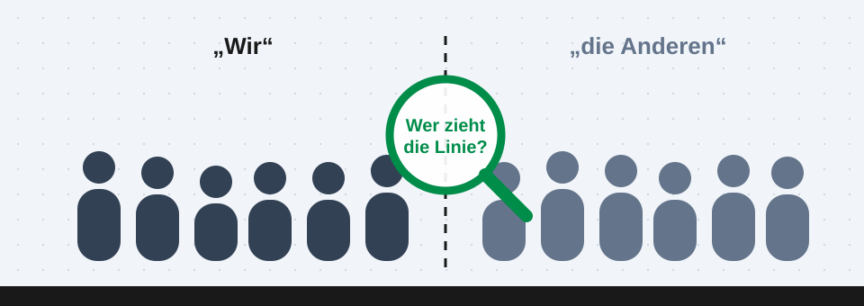

# Willkommen {.unnumbered}

::: {.oth-frame}
{.welcome-banner fig-alt="Eine Gruppe von Menschen, durch die eine gestrichelte Linie gezogen ist. Links steht „Wir“, rechts „die Anderen“. Eine Lupe in der Mitte fragt: Wer zieht die Linie?"}
:::

„Woher kommst du wirklich?“ Die Frage klingt harmlos, oft sogar interessiert. Für viele Menschen, die in Deutschland geboren und aufgewachsen sind, ist sie dennoch eine alltägliche Erfahrung des Ausgeschlossenwerdens. Sie zieht eine Linie zwischen einem „Wir“ und „den Anderen“, ohne dass jemand eine böse Absicht haben muss. Genau hier setzt Rassismuskritik an: Sie fragt nicht zuerst, wer Rassist:in ist, sondern wie solche Linien entstehen, wem sie nützen und welche Folgen sie haben.

Für die Soziale Arbeit ist das keine akademische Frage. Ihre Adressat:innen machen Rassismuserfahrungen in Schule, Behörden und auf dem Wohnungsmarkt. Zugleich zieht die Soziale Arbeit selbst Linien, in Hilfeplänen, Gutachten und Zielgruppenlogiken. Wer Rassismus nur als individuelles Vorurteil versteht, übersieht diese Verstrickung. Wer ihn nur als Struktur beschreibt, verliert die eigene Verantwortung aus dem Blick. Die Lehrveranstaltung stellt die Begriffe und Theorien bereit, mit denen sich beides zusammen denken lässt.

Das Skript begleitet die Sitzungen. Es bündelt die zentralen Inhalte, erläutert Theorien und Begriffe und bietet Lernspiele, mit denen Sie Ihr Wissen anwenden können. Es ersetzt nicht die Lektüre, erleichtert aber den Einstieg.

::: {.callout-note appearance="simple" icon=false}
### Ein Hinweis zum Umgang miteinander
Rassismuskritik ist nicht nur Wissensvermittlung, sondern auch Reflexionsarbeit. Im Seminar sitzen Menschen mit und ohne Rassismuserfahrungen. Wenn das Skript diskriminierende Aussagen zitiert, dann um sie zu analysieren, nicht um sie zu wiederholen. Es geht um Verantwortung, nicht um Schuld.
:::

## Ziele der Lehrveranstaltung

Nach der Lehrveranstaltung können Sie

1. **definieren**, was Rassismus, Diskriminierung und gruppenbezogene Menschenfeindlichkeit sind und wie sie sich unterscheiden,
2. **erläutern**, wie postkoloniale Theorie, Critical Race Theory, Intersektionalität und Kritische Weißseinsforschung Rassismus als Machtverhältnis erklären,
3. **analysieren**, wie sich antimuslimischer Rassismus, türkischer Ultranationalismus und Antisemitismus zeigen und was sie voneinander unterscheidet,
4. **erkennen**, wo Kulturalisierung und institutioneller Rassismus in Praxisfeldern der Sozialen Arbeit wirken,
5. **beurteilen**, welche Handlungsansätze, von Empowerment bis Organisationsentwicklung, in welcher Situation tragen,
6. **reflektieren**, welche Position Sie selbst in rassistischen Verhältnissen einnehmen und was daraus für Ihr professionelles Handeln folgt.

## Wo Sie anfangen können

::: {.grid .welcome-cards}

::: {.g-col-12 .g-col-md-6 .welcome-card}
[]{.bi .bi-journal-text .welcome-icon}

**Grundlagen · [Grundbegriffe](grundlagen/01-grundbegriffe.qmd)**

Die wichtigsten Begriffe zum Aufklappen, mit typischen Verwechslungen.
:::

::: {.g-col-12 .g-col-md-6 .welcome-card}
[]{.bi .bi-diagram-3 .welcome-icon}

**Sitzungen · [13 Sitzungen](index.qmd)**

Vier Blöcke: Begriffe und Theorien, Erscheinungsformen, Praxisfelder und Handlungsansätze, Organisation und Positionierung.
:::

::: {.g-col-12 .g-col-md-6 .welcome-card}
[]{.bi .bi-controller .welcome-icon}

**Üben · [Lernspiele](03-lernspiele.qmd)**

Memory zu den Grundbegriffen und Aussagen den Theorien zuordnen.
:::

::: {.g-col-12 .g-col-md-6 .welcome-card}
[]{.bi .bi-check2-circle .welcome-icon}

**Üben · [Lernkontrolle](04-lernkontrolle.qmd)**

Prüfen Sie, was Sie sicher anwenden können.
:::

:::

## Hinweis zur Transparenz

Künstliche Intelligenz wurde eingesetzt, um die Lernspiele zu programmieren, Texte und Erläuterungen auf Grundlage der Seminarfolien zu entwerfen und die Abbildung auf dieser Seite zu erstellen. Alle Inhalte wurden vom Autor geprüft, der für sie verantwortlich ist.
